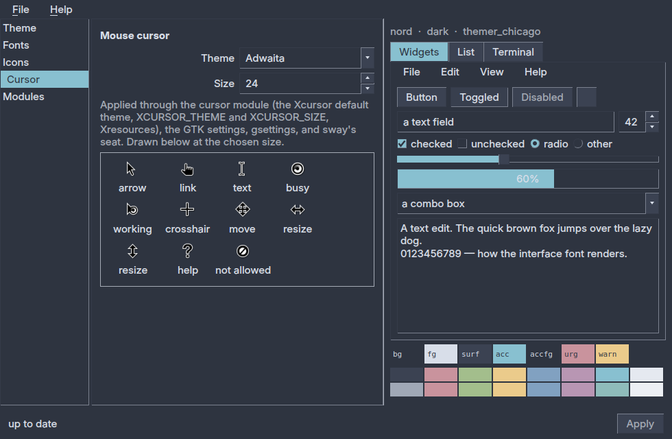
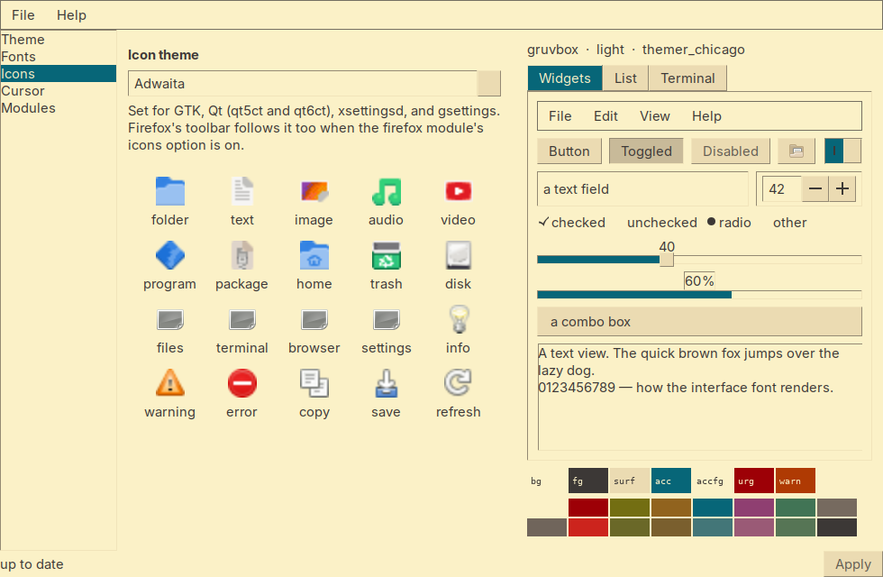

# themer

**One theme, one dark/light switch, applied to the whole desktop — and undone the same way.**

themer is a suckless-style theme manager written in C99. It takes a colour theme and a
mode (dark or light) and writes the configuration of everything on the desktop from
them: GTK 2/3/4, Qt 5/6, Firefox, Thunderbird, sway or i3, waybar, foot, nvim, fcitx5,
launchers, newt dialogs, the TTY — and YouTube and Wikipedia, through Stylus. Every write is recorded, so unloading a module puts
the user's files back byte for byte.

The look itself comes from a template set. Themer Default, the default, is GNOME's
Adwaita in the theme's colours, with Firefox and the web sites left as they come and
recoloured; Themer Chicago is flat, square and outlined everywhere. A set of your own
is a directory of ordinary theme files with `{{variables}}` in them.

It replaces nwg-look, qt5ct and qt6ct: icons, cursor, fonts and font rendering are
applied from the same state, and Qt programs are themed through themer's own platform
theme plugin.

```
themer                 # the TUI
themer-gtk             # the same, as a GTK window with a live preview
themer-qt              # ... or a Qt window
themer-web             # ... or a page in the browser, on localhost
themer toggle          # flip dark/light, apply everywhere
themer theme gruvbox   # switch theme, apply everywhere
```

<p align="center">
  
  
</p>
<p align="center"><sub>themer-gtk with Themer Default: the same theme in dark and light. The window and the preview on the right are drawn with the GTK theme the gtk module writes: GTK's Adwaita in the theme's colours.</sub></p>

<p align="center">
  
  
</p>
<p align="center"><sub>Firefox 140 with the firefox module and Themer Chicago: three flat rows, tabs like sway's, the URL bar in the terminal font.</sub></p>

## Contents

- [Build and install](#build-and-install)
- [Usage](#usage)
- [Setting up Firefox, Thunderbird and Stylus](#setting-up-firefox-thunderbird-and-stylus)
- [Front ends](#front-ends)
- [What apply covers](#what-apply-covers)
- [Qt](#qt)
- [Environment](#environment)
- [Modules](#modules)
- [Templates](#templates)
- [Writing a template set](#writing-a-template-set)
- [Design language](#design-language)
- [Readability](#readability)
- [Firefox](#firefox)
- [Stylus (web sites)](#stylus-web-sites)
- [Thunderbird](#thunderbird)
- [Colour schemes](#colour-schemes)
- [Fonts](#fonts)
- [Writing a module](#writing-a-module)
- [Upgrading](#upgrading)
- [Status and license](#status-and-license)

## Build and install

```sh
make                  # host, modules, and whichever front ends the system can build
make check            # render every template, then an apply/unload round trip in a throwaway HOME
sudo make install     # to PREFIX (/usr/local); an earlier install is removed first
sudo make uninstall   # removes all of that; ~/.config/themer is yours and stays
```

`make` builds `themer-gtk` when `pkg-config` finds `gtk+-3.0`, `themer-qt` when it
finds `Qt6Widgets` or `Qt5Widgets` and a C++ compiler, and the Qt platform theme
plugin for each Qt major it finds. It prints what it found; `GTK=0` or `QT=0` skips
one on purpose. The only hard dependencies are a C compiler and libc.

| Make target | What it does |
|---|---|
| `make` | host binary, modules, front ends, Qt plugin |
| `make check` | templates rendered for every theme and mode; apply/unload round trip (`test/run.sh`) |
| `FIREFOX=/path/to/firefox sh test/firefox.sh [theme] [dark\|light]` | renders the chrome in a real Firefox under Xvfb; screenshots to `test/firefox/out/` |
| `sudo make install` | binaries to `PREFIX/bin`, themes/templates/icons to `PREFIX/share/themer`, modules to `PREFIX/lib/themer/modules`, the Qt plugin to `PREFIX/lib/themer/qt`, the module header to `PREFIX/include/themer` |
| `make dist` | `themer-VERSION.tar.gz` from the git tree |

**Arch:** `dist/PKGBUILD` and `dist/themer.install`. Run `make dist`, then `makepkg -si`
next to the tarball. The Qt plugin is built against the installed Qt and must be
rebuilt after a Qt minor upgrade; a package makes that one command.

`themer -v` prints the version; `VERSION` is set at the top of the Makefile.

### Layout

| Directory | Contents |
|---|---|
| `src/` | the host: one binary. `main.c` the command line; `state.c` the state file; `registry.c` finds modules and runs apply; `manifest.c` the `tm_*` helpers modules write with, and the undo log; `template.c` and `palette.c` the templates and shared variables; `theme.c` the theme files and readability rules; `targets.c` the env, tty, and grub targets; `front.c` the layer every front end calls; `tui.c`, `fonts.c`, `preview.c` the interactive parts |
| `gui/` | `themer-gtk` (GTK 3, C), `themer-qt` (Qt 5 or 6, C++) and `themer-web` (C, with its page in `web/index.html`); `common.c` is what they share; `qpa/` the Qt platform theme plugin |
| `include/` | `themer_module.h`, the API modules are built against |
| `modules/` | one `.c` per module; `wm.h`, `launcher.h`, `icons.h` are shared code |
| `templates/` | `templates/<set>/<dir>/<file>`; a set is one directory (`themer_default` and `themer_chicago` are built in), `<dir>` is named by the module |
| `themes/` | `<name>.theme`, a `[dark]` and a `[light]` section each |
| `icons/` | Adwaita's symbolic icons, the fallback for the Firefox toolbar |
| `tools/` | `adwaita/build.sh`, which makes the GTK files of `themer_default` from GTK's own Adwaita (see [Templates](#templates)) |
| `test/` | `make check`, a shell script (its themer-web checks use `curl`, and are skipped without it); `firefox.sh` screenshots a real Firefox, by hand; `gogh-schemes.txt`, the Gogh collection the shipped schemes were imported from |

## Usage

```
themer                              TUI
themer-gtk | themer-qt [PAGE]       the same settings in a window, with a live preview;
                                    PAGE: theme, fonts, icons, cursor, modules, env,
                                    or server (modules NAME opens one module)
themer-web [-p PORT] [-d | -q]      the same in the browser at http://localhost:7331/
                                    (-d detach, -q stop the one running); runs only
                                    while a browser module (firefox, stylus) is on;
                                    started while one runs, it opens that one's page
themer apply                        re-apply everything and save state (run at login)
themer toggle                       flip dark/light and apply
themer dark | light                 set mode and apply
themer theme NAME                   switch theme and apply
themer list                         list themes
themer check                        list every color the readability rules adjust
themer env [NAME=VALUE]             list the session's variables, or set one (NAME=
                                    removes it) and apply
themer color [ROLE HEX|reset]       list the colors (yours marked), or put one of your
                                    own over the scheme's (bg fg surf acc accfg urg
                                    warn), or reset it, and apply
themer icons [NAME]                 show (current first) or set the icon theme and apply
themer cursor [NAME [SIZE]]         show or set the cursor theme and size and apply
themer font ui|mono FAMILY [SIZE]   set the interface or terminal font and apply
themer font tty [NAME]              list the console fonts, or set one and apply
themer render [hinting none|slight|medium|full] [antialias on|off]
              [rgba none|rgb|bgr|vrgb|vbgr]
                                    show or set font rendering and apply
themer set                          show the template set
themer set NAME                     switch every module to template set NAME and apply
themer set list                     list the sets and the modules each covers
themer set copy FROM TO             copy a set under a new name, to edit
themer set import NAME MODULE PATH  turn an existing theme into (part of) a set
themer set check NAME               render every file of NAME for every theme
themer module list                  list modules, on/off, description
themer module load|unload NAME      load (write its files) or unload (remove them) now
themer module options NAME          list a module's options by section; * marks a set value
themer module option NAME KEY VALUE set one; a loaded module reloads at once
themer module reset NAME KEY        back to the default (template: the global set)
themer server start|stop|status     themer-web: start it, stop it, or say whether it runs
themer server port N                its port (a running server moves to it)
themer server install [SITE]        open the userstyles (or one site's) in the browser,
                                    for Stylus to install; starts the server if need be
themer scheme import FILE [NAME]    add a colour scheme (see Colour schemes)
themer scheme remove NAME           delete one of yours, or hide a built-in one
themer scheme restore [NAME]        bring hidden built-in schemes back
themer template list DIR [SET]      list template sets, or the files in SET
themer template render MODULE SET FILE [OUT]
                                    render one template with the current theme
themer -v                           version
```

**Lookup, most specific first:**

| | |
|---|---|
| themes | `$THEMER_THEMES`, `~/.config/themer/themes`, `PREFIX/share/themer/themes` |
| modules | `$THEMER_MODULES`, `~/.config/themer/modules`, `PREFIX/lib/themer/modules` |
| templates | `~/.config/themer/templates`, `$THEMER_TEMPLATES`, `PREFIX/share/themer/templates` (built-in sets are mirrored into the first; see [Templates](#templates)) |
| icons | `$THEMER_ICONS`, `PREFIX/share/themer/icons` (the Firefox fallback only) |

Running from the source tree:

```sh
THEMER_THEMES=$PWD/themes THEMER_MODULES=$PWD/modules \
THEMER_TEMPLATES=$PWD/templates THEMER_ICONS=$PWD/icons ./themer
```

**State** lives in `~/.config/themer/state`: theme, mode, template set, fonts, icon
theme, cursor theme and size, font rendering, environment, which modules are on, and
option values. Compile-time defaults are in `config.def.h`.

## Setting up Firefox, Thunderbird and Stylus

Most modules work as soon as they are on. These three need a step or two in the
program itself the first time, because themer does not change a program's own
settings for it.

### Firefox

1. **Let Firefox read user stylesheets.** Open `about:config`, accept the warning,
   search for `toolkit.legacyUserProfileCustomizations.stylesheets` and set it to
   `true` (double-click it). Without it Firefox ignores `userChrome.css`, which is
   where the theme goes. themer does not write `user.js` for you.
2. **Apply.** `themer apply`, or Apply in any front end, with the firefox module on
   (it is by default). The output names the profile it wrote to:
   `themer: firefox profile: ~/.mozilla/firefox/xxxx.default-release`.
3. **Restart Firefox.** It reads its stylesheets at startup only, so every later
   apply (another theme, dark/light) shows after a restart too; the output says when
   a running Firefox holds the profile.

The profile written to is the one a running Firefox holds, otherwise the one used most
recently (profiles in `~/.mozilla/firefox`, `~/.config/mozilla/firefox`, the snap and
the Flatpak). With several profiles, start Firefox with the one you want, then apply.

### Thunderbird

1. **Let Thunderbird read user stylesheets.** Settings, General, at the very bottom
   **Config Editor…**; search for `toolkit.legacyUserProfileCustomizations.stylesheets`
   and set it to `true`.
2. **Apply** with the thunderbird module on; the output names the profile.
3. **Restart Thunderbird**, now and after every later apply.

### Stylus (web sites)

1. **Install the Stylus extension** in your browser: from addons.mozilla.org for
   Firefox, from the Chrome Web Store for the Chromium family.
2. **Apply** with the stylus module on. It renders a style per site into
   `~/.config/themer/stylus/` (YouTube and Wikipedia ship).
3. **Install each style once:** **Install** beside the site in the stylus module's
   options (Modules, stylus, What it themes) in any front end, or
   `themer server install` for every site (`themer server install youtube` for one).
   That starts the server if it is stopped and opens the style in your default browser
   (xdg-open), where Stylus shows its install page: click **Install style**. Stylus
   asks for that click itself, so no program can install a style for you. The server
   keeps running while a browser module (firefox or stylus) is on.
4. **Later applies** reach Stylus through the style's update address, while the server
   runs: Stylus checks on its own schedule (its options set how often), or at once with
   *Check for updates* in Stylus's style manager. To see each apply instantly instead,
   tick **Live reload** on the install page and leave that tab open.

The styles set every color themselves, whichever of its own modes a site is in, but
a site in the other mode can still show its own colors in a corner the style does
not reach yet. The sites follow the desktop: themer sets the desktop's color scheme
(`color-scheme` in gsettings, which Firefox reads through the portal) to the mode, so
with Firefox's **Settings, General, Website appearance** on *Automatic* and YouTube's
and Wikipedia's own appearance on *device theme* / *Automatic*, they match.

A site you do not want themed: switch it off under Modules, stylus, What it themes
(`themer module option stylus youtube off`). Like every module, stylus has `mode`, so the
sites can stay dark on a light desktop. Without the server, a style can be installed
from its file (`file:///home/you/.config/themer/stylus/youtube.user.css`; in Chromium,
first allow Stylus access to file URLs), with Live reload on.

## Front ends

The CLI, the TUI, `themer-gtk`, `themer-qt` and `themer-web` are faces of one layer
(`src/front.c`); every setting and action is reachable from each, and Apply runs the
same `themer apply` whichever one you used.

`themer-gtk` and `themer-qt` are the TUI as a window, like nwg-look: pages for the
theme (the scheme, the mode, the set, and colors of your own over the scheme's), the
fonts (the console font too), the icon theme, the cursor, the modules, the environment
and the server on the left, a preview on
the right, Apply at the bottom (Ctrl+S; Revert to applied undoes browsing), File and
Help menus. The preview is the real thing, not a mock-up: the window restyles itself
from the `gtk.css` (or `qt.qss` and palette) the gtk (or qt) module would write for the
selected theme, so what the widgets look like there is what every GTK (or Qt) app will
look like after Apply. The Icons page shows the selected icon theme's own icons, the
Cursor page draws the cursor theme's own files at the chosen size, the Terminal tab the
terminal font and colours, and the swatches the roles and the sixteen terminal
colours. Nothing is written until Apply. Closing with unapplied changes asks first.

Template sets from the window: on the Theme page, **New set** copies the selected set
under a new name into `~/.config/themer/templates/`, **Import theme** turns a theme you
already have into part of a set (a GTK theme directory, a `.qss`, a `chrome/`
directory...), **Check** renders the selected set for every theme and shows the report.
The TUI has the same under *Template set* (`n`, `i`, `c`).

The four front ends have the same pages in the same order, **Theme**, **Fonts**,
**Icons**, **Cursor**, **Modules**, **Server** (the TUI's main menu has them as
sections), and draw the same control for the same kind of setting: on/off is a
switch, a few short choices are buttons side by side with the chosen one in the
accent (the mode, a module's font), a number in a range is a slider with its value,
the template set is a list shown by its title (Themer Default; `themer_default` is its
directory name). A font is a family and a size, set apart.

**Modules**: the modules on the left with their state (on, off, not installed), the
selected one on the right with its switch and its options in two sections, in the same
order everywhere: **Look** (`mode`, `font`, `template` and the module's other settings)
and **What it themes** (the on/off parts: GTK 2/3/4, Qt 5/6, each Stylus site). Each
option shows what it does; a changed one shows its default and a Reset button. A
module's switch and its options take effect at once; Apply is for the theme, fonts,
icons and cursor. In the TUI: `l` into the options, `h`/`l` change one, enter picks
from a list or types a value, `r` resets.

**Server**: `themer-web`, the same settings as a page on localhost for when the
browser is what you have open, and what serves the stylus module's userstyles. It is
started and stopped by hand there (or `themer server start`), on the port set there
(7331); it runs only while a browser module is on, and stops by itself a few seconds
after the last one is turned off. It answers only requests for `localhost:PORT` and
changes nothing without the page's own header, so other sites open in the browser
cannot drive it.

<p align="center">
  
  
</p>
<p align="center">
  
  
</p>
<p align="center"><sub>themer-qt (nord dark) and themer-gtk (gruvbox light): the Cursor page draws the cursor theme's own files, the Icons page the icon theme's, and the Modules page holds every module's options.</sub></p>

`themer-qt` needs no moc. `make gui` repeats what the build found; `make themer-gtk` or
`make themer-qt` builds one on purpose.

## What apply covers

The ground nwg-look and qt5ct/qt6ct cover, from one state, whichever front end set it:

| Module | Writes |
|---|---|
| **gtk** | `~/.config/gtk-3.0/settings.ini` and `gtk-4.0/settings.ini`: theme, icon theme, cursor theme and size, font, prefer-dark, Xft antialias/hinting/hintstyle/rgba; the same keys in `~/.gtkrc-2.0` (GTK 2) and `~/.config/xsettingsd/xsettingsd.conf` (xsettingsd gets SIGHUP); the `org.gnome.desktop.interface` gsettings keys (gtk-theme, icon-theme, cursor-theme, cursor-size, font-name, monospace-font-name, color-scheme, font-antialiasing, font-hinting, font-rgba-order) when gsettings is installed (`gsettings=off` turns that off) |
| **qt** | `~/.config/themer/qt/theme.conf` and `themer.qss` for themer's platform theme plugin (style, palette, icon theme, fonts, stylesheet), and `qt5ct.conf` / `qt6ct.conf` with the same where those tools are installed. qt5ct's Interface page is yours and is left as it is |
| **cursor** | `~/.icons/default/index.theme` and `~/.local/share/icons/default/index.theme` (`Inherits=`), `XCURSOR_THEME` and `XCURSOR_SIZE` in environment.d, `Xcursor.theme/size` in `~/.Xresources` (merged with xrdb when an X server runs); sway gets `seat * xcursor_theme` from the sway module, i3 reads the Xresources |
| **fontconfig** | `~/.config/fontconfig/conf.d/50-themer-rendering.conf`: antialias, hinting, hintstyle, rgba, lcdfilter, for everything that is not GTK |

Icon and cursor themes are listed from `~/.icons`, `~/.local/share/icons`,
`/usr/share/icons` and `/usr/local/share/icons`; a cursor theme is one with a `cursors/`
directory. Any name can also be typed.

## Qt

Qt programs take a palette, fonts, an icon theme and a style only from a *platform
theme* plugin, which is why qt5ct and qt6ct exist. themer brings its own:
`gui/qpa/themerqpa.cpp`, built once per Qt major that `make` finds and installed under
`PREFIX/lib/themer/qt/qt5/` and `qt6/`. The qt module writes
`~/.config/themer/qt/theme.conf` (style, icon theme, fonts, the palette) and
`themer.qss`, and sets `QT_QPA_PLATFORMTHEME=themer` and `QT_PLUGIN_PATH` in its
environment file. The plugin watches those files, so an apply restyles running Qt
programs at once. The style is Fusion under the set's stylesheet: Themer Default's draws
after Adwaita (rounded controls, buttons in the `control` tints, views on `view`, the
accent for selection and anything switched on), Themer Chicago's is flat and bevelled.

Where the plugin is not installed for your Qt, the module falls back to qt5ct (and
qt6ct) when they are installed; the `platformtheme` option forces either. Qt reads the
environment at start — see [Environment](#environment).

## Environment

Several things are environment variables: `QT_QPA_PLATFORMTHEME` and `QT_PLUGIN_PATH`,
`XCURSOR_THEME` and `XCURSOR_SIZE`, the fcitx input-method variables, and whatever you
set with `themer env`. themer writes them to `~/.config/environment.d/*themer*.conf`,
which reaches programs when the session is started through systemd (a display manager,
or sway as a user service).

When you start the compositor yourself from a tty, nothing reads environment.d. Source
the script themer also writes, from your shell profile, before the compositor starts:

```sh
. ~/.config/themer/env.sh      # in ~/.profile, ~/.zprofile, or ~/.bash_profile
```

Check with `echo $QT_QPA_PLATFORMTHEME` in a terminal inside the session: empty means
the variables are not reaching your programs, and Qt will look plain however the rest
is set up. themer never writes `/etc/environment`; if that is where your session reads
from, the two lines to add are:

```
QT_QPA_PLATFORMTHEME=themer
QT_PLUGIN_PATH=/usr/local/lib/themer/qt/qt5:/usr/local/lib/themer/qt/qt6
```

## Modules

**Detection.** A module says whether the program it themes is here (`present()` in the
module API: the binary on `PATH`, a config file, a profile, a socket). An absent one is
listed as *absent* by `themer module list`, shown as *(not installed)* in the TUI and
the GUIs, and skipped by apply; it stays on, so it takes effect as soon as the program
appears. Modules without a check (gtk, cursor, fontconfig, newt, st) always write; their
files are harmless where the program is missing.

All on by default unless noted:

| Module | Themes |
|---|---|
| **gtk** | a GTK 3/4 theme written to `~/.config/themer/gtk/`, reached by GTK through a link `~/.themes/<set>` named after the template set (`themer_default`, labelled "Themer Default"); no `GTK_THEME` is set, since that would override the file and go stale. libadwaita programs, which load no named theme, get the set's `libadwaita.css` (or its whole `gtk.css`) through `~/.config/gtk-4.0/gtk.css`. Options `gtk2`, `gtk3`, `gtk4` turn each version off. Restarts the GTK file-chooser portal on apply so Firefox's file dialogs on Wayland follow without a logout. A GTK app keeps the theme it loaded at launch: restart it, or log out |
| **qt** | Qt 5 and 6: palette, flat stylesheet, icons, fonts, through the platform theme plugin; where qt5ct/qt6ct are installed their configs are written too. Options `qt5`, `qt6`, `platformtheme` |
| **cursor** | the mouse cursor theme and size: Xcursor default theme, `XCURSOR_*`, Xresources |
| **fontconfig** | font rendering for everything that reads fontconfig |
| **firefox** | the browser chrome (`chrome/userChrome.css`) and Firefox's own pages (`chrome/userContent.css`), as marked blocks in the profile |
| **thunderbird** | the mail window and the panes Thunderbird draws as content, the same way |
| **stylus** | userstyles for web sites, for the Stylus extension in Firefox or Chromium: `~/.config/themer/stylus/<site>.user.css`, one per `*.user.css` in the set (YouTube and Wikipedia ship). Installed once through the server (`themer server install`); Stylus then picks up every apply on its own |
| **sway** | window and bar colours, the font, `$menu`, the seat cursor; loads only where sway is in use. Borders, gaps and titlebars stay in your own config |
| **i3** | the same for i3 |
| **waybar** | the bar's style; owns `style.css` (yours is kept in `~/.config/themer/originals/` and put back on unload); under sway it replaces sway's own bar. `config.jsonc` is not touched |
| **foot** | font and colours in `foot.ini` (`[colors-dark]` and `[colors-light]`, foot 1.15+, plus `initial-color-theme`) |
| **nvim** | a `themer` colorscheme, selected from the end of `init.lua` or `init.vim` |
| **fcitx** | fcitx5 input-method variables and candidate-window theme |
| **wmenu** | a launcher script, `~/.config/themer/bin/themer-wmenu`, in the theme's colours |
| **dmenu** | the same for dmenu |
| **newt** | `NEWT_COLORS` for nmtui and other newt dialogs, each colour mapped to the nearest terminal colour. Set in environment.d; copy the line to your shell profile for programs started elsewhere |
| **st** *(off)* | a colours header; st's `config.h` needs one edit, see `modules/st.c` |
| **example** *(off)* | the template module to copy |

Built-in targets, not modules: **env** (`environment.d/50-themer.conf`), **tty** (the
console palette and font, as root), **grub** (as root). They write system files the
undo log cannot cover.

**How modules change files.** Every write goes through the `tm_*` helpers in
`themer_module.h` and is recorded in `~/.config/themer/undo/<module>.manifest`. Before
a module first edits one of your files in place (your sway config, `foot.ini`,
`settings.ini`...), the file is copied to `~/.config/themer/originals/`. Unloading puts
that copy back byte for byte when the file is as the module left it; when you have
changed the file since, the module's edits are taken out one by one instead (marked
blocks cut, ini keys and replaced lines given their old values, switched-off lines
switched back on), so your own changes stay. Files themer generated are deleted (only
while still its own), and directories it created are removed when empty. Every file is
written to a temporary file and renamed into place, so a crash never leaves one half
written, and a symlinked dotfile stays a symlink. Applying runs unload-then-load, so
re-applying never duplicates anything; editing your configs while a module is on is
fine. After a change each module's reload hook tells its running program: sway and i3
are reloaded when their socket variable is set, waybar gets SIGUSR2, xsettingsd gets
SIGHUP.

### Where themer keeps its files

Everything of themer's own is under `~/.config/themer`; the configs a module generates
go where each program reads them.

```
~/.config/themer/
  state            your settings: theme, mode, fonts, icons, modules, options, port
  themes/          your colour schemes (imported ones too); .removed: hidden built-ins
  templates/       template sets (the built-in ones mirrored here, to edit)
  modules/         modules of your own (.so)
  undo/            what each module wrote, so it can be taken back
  originals/       your files as they were before a module edited them
  stylus/          the rendered userstyles
  bin/             the launcher scripts ($menu for sway and i3)
  qt/ gtk/ ...     files a module keeps for itself
  cache/           font specimens, the TUI's error log
  env.sh, tty.rgb  the environment and the console palette
```

### Module options

Set them on the Modules page of any front end, or with `themer module option`; `themer
module reset` puts one back to its default. Two options every module has:

- **`mode`** (`auto` \| `dark` \| `light`, default `auto`): which side of the theme the
  program uses. `auto` follows the global mode; `dark` or `light` pins that program to
  that side whatever the global mode is, say a dark terminal on a light desktop. The
  host renders the module from that side, so it works for third-party modules too.
  Modules that draw no colours (cursor, fontconfig) have none.
- **`template`**: the template set it is drawn from. Unset, it follows the global set
  (`themer_default` by default); set, it pins that module to a set of its own.

| Module | Option | Values | Default |
|---|---|---|---|
| gtk | `font` | `ui` \| `terminal` | `ui` |
| | `gtk2`, `gtk3`, `gtk4` | `on` \| `off` | `on` |
| | `gsettings`, `xsettingsd` | `on` \| `off` | `on` |
| qt | `font` | `ui` \| `terminal` | `ui` |
| | `qt5`, `qt6` | `on` \| `off` | `on` |
| | `platformtheme` | `auto` \| `themer` \| `qt5ct` | `auto` (the plugin when installed) |
| firefox | `font` | `ui` \| `terminal` | `ui` |
| | `icons` | `0`–`8`, glyph size in points above the text | `2` |
| | `size` | icon size in pixels, `0` = text size plus `icons` | `0` |
| | `style` | `firefox` (Firefox's own icons) \| `image` (the icon theme's icons, recoloured) \| `mask` (the icon theme's shapes in the bar ink) | `image` |
| | `recolor` | `all` \| `symbolic` | `all` |
| | `raster` | `color` \| `ink` | `color` |
| thunderbird | `font` | `ui` \| `terminal` | `ui` |
| stylus | `font` | `ui` \| `terminal` \| `site` (the site's own) | `ui` |
| | one per site: `youtube`, ... | `on` \| `off` (off leaves the site alone) | `on` |
| waybar | `font` | `ui` \| `terminal` | `terminal` |
| | `padding` | `tight` \| `normal` \| `loose` | `normal` |
| fcitx, wmenu, dmenu | `font` | `ui` \| `terminal` | `ui` |
| sway, i3 | `font` | `ui` \| `terminal` | `ui` |
| | `menu` | `auto` \| `wmenu` \| `dmenu` \| `none` | `auto` |
| | `bar` | `auto` (your `bar { }` blocks switched off and replaced: by waybar under sway when the waybar module is on, by themer's bar otherwise, which keeps your bar's `status_command`) \| `themer` (always themer's bar) \| `keep` (yours as it is) | `auto` |
| example | `style` | `short` \| `long` | |

## Templates

A module's files come from templates. A set is one directory,
`~/.config/themer/templates/<set>/`, holding one subdirectory per module (modules with
the same output share one) and one file per output:

```
gtk/          gtk.css                        GTK 3 and 4
qt/           qt.qss, colors.conf, *.svg     the plugin, qt5ct and qt6ct
firefox/      userChrome.css, userContent.css
thunderbird/  tokens.css, chrome.css, content.css
stylus/       youtube.user.css, wikipedia.user.css, ...  Stylus userstyles, one per site
wm/           themer.conf, bar.conf          sway and i3
launcher/     launcher                       wmenu and dmenu
waybar/       style.css
nvim/         themer.lua, select.lua, select.vim
fcitx/        theme.conf
newt/         newt.conf
st/           colors.h
example/      colors
set.conf      name=, description=, author=, url=   (optional)
```

Two sets are built in:

- **themer_default** (Themer Default), the default: GNOME's Adwaita in the theme's
  colours. GTK 3 and GTK 4 get GTK's own Adwaita (see below), libadwaita programs keep
  libadwaita's look with its named colours set from the theme, Qt gets a stylesheet
  drawn after Adwaita, and Firefox, Thunderbird, YouTube and Wikipedia stay as they
  come, recoloured: only their colour variables are set, nothing is moved, resized or
  rounded differently.
- **themer_chicago** (Themer Chicago): flat, square and outlined everywhere, with a
  Chicago bevel on controls and sway-style tabs, and the icon theme's icons in the
  Firefox toolbar.

They are installed under `PREFIX/share/themer/templates`, and every start of themer
mirrors them into `~/.config/themer/templates/<set>/`, which is the copy that is used:
edit it there. The mirror keeps itself current without losing your edits:

- a file you have not touched follows the built-in when `make install` brings a new one;
- a file you changed is yours and stays (themer says so once if the built-in moved on,
  naming the new one under `PREFIX` to compare);
- a file you delete comes back;
- a copy left by an old build that differs is replaced and kept beside as `<file>.themer-old`;
- a mirrored file whose built-in is gone after an upgrade is removed again, unless you changed it.

How it tells the two apart is `.seeded` in that directory, a hash of each file as
themer last wrote it. Your own sets live next to them, with names of letters, digits,
`-` and `_` (not a built-in set's name).

**Switching sets:** `themer set NAME` makes every module render from `NAME` and
applies. A set need not cover every module: what it lacks comes from `themer_default`,
so a set that restyles only Firefox still applies to the whole desktop. One module can
be pinned to another set with its `template` option: `themer module option firefox
template themer_chicago` gives Firefox the Chicago chrome under Themer Default.

To work on the look, edit `~/.config/themer/templates/<set>/` and apply. For a
variant of your own:

```sh
themer set copy themer_default mine
# edit ~/.config/themer/templates/mine/
themer set mine
```

**Themer Default's GTK files** are not written by hand. `tools/adwaita/build.sh`
compiles the SCSS of GTK 3's Adwaita and GTK 4's default theme (from a GTK source tree)
with every colour left open: where Adwaita works out a shade at build time (darken,
mix, transparentize), the output has the GTK expression that works it out from the
theme's colours when GTK loads the file (`mix()`, `alpha()`), scaled so that Adwaita's
own palette comes out as Adwaita. The few base colours are named at the top of each
file from the theme (`@define-color themer_bg_color #{{bg}};` and so on), so editing
those recolours the whole theme. Re-run it to follow a new GTK release:

```sh
git clone --depth 1 -b gtk-3-24 https://gitlab.gnome.org/GNOME/gtk.git gtk3
git clone --depth 1 -b gtk-4-24 https://gitlab.gnome.org/GNOME/gtk.git gtk4
tools/adwaita/build.sh gtk3 gtk4 /path/to/dart-sass/sass
```

GTK 3 picks `gtk-dark.css` and GTK 4 its `gtk4-dark.css` in dark mode, as for any
theme; the GTK 4 files avoid the relative colours GTK took in 4.16, so they load in
older GTK 4 too.

## Writing a template set

A set is a directory of ordinary theme files with `{{variables}}` in them. Nothing
else: no build, no manifest format, and a set may cover one module or all of them. The
quickest start is a theme you already use:

```sh
themer set import mylook gtk ~/.themes/Gruvbox-Material          # a GTK theme dir
themer set import mylook qt ~/.config/qt5ct/qss/mine.qss         # a Qt stylesheet
themer set import mylook firefox ~/.mozilla/firefox/x.default/chrome
themer set import mylook waybar ~/.config/waybar/style.css
themer set check mylook
themer set mylook
```

Import takes a file or a directory. It knows the usual layouts (a GTK theme's `gtk-3.0/`
and `gtk-4.0/`, a profile's `chrome/`) and otherwise takes the directory as it is. Each
text file goes under the name the module renders, with a `generated by themer` marker
line at the top, and **every colour in it that equals one of the current theme's colours
is replaced by that colour's variable**: `#282828` in a file imported under gruvbox dark
becomes `#{{bg}}`, `#83a598` becomes `#{{acc}}`. So import with the theme and mode the
look was made for, and the file follows every theme from then on. Colours that match
nothing stay literal and are listed in the report. Everything that is not text (images,
fonts, `assets/`) is copied as it is and placed beside the module's output on apply, so
`url("assets/x.png")` keeps working.

What each module directory takes, and what becomes of it on apply:

| Directory | File | On apply |
|---|---|---|
| `gtk/` | `gtk.css` | rendered to `~/.config/themer/gtk/gtk-3.0/gtk.css` and `gtk-4.0/gtk.css`. The set's `gtk.css` is the whole theme: there is no Adwaita underneath it |
| | `gtk-dark.css` | optional: what GTK loads in dark mode |
| | `gtk4.css`, `gtk4-dark.css` | optional: GTK 4's own `gtk.css` and `gtk-dark.css`, in place of the shared ones (which then go to GTK 3 only). A set with them is a whole GTK 4 theme and is named for GTK 4; without them GTK 4 keeps its own theme beneath the set's `gtk.css` |
| | `libadwaita.css` | optional: what libadwaita programs get through `~/.config/gtk-4.0/gtk.css`, which they read instead of a named theme; without it they get the whole `gtk.css` (so the set restyles them), with it only what it says (Themer Default sets libadwaita's named colours) |
| | any other `.css` / anything else | rendered / copied into both directories |
| `qt/` | `qt.qss` | to `~/.config/themer/qt/themer.qss` (and qt5ct/qt6ct's copies). `{{qt_assets}}` is the directory it lands in: `url({{qt_assets}}/x.svg)` for images, since a Qt stylesheet's `url()` is not relative to the stylesheet |
| | `*.svg` | rendered like templates (arrows, check marks in the theme's colours) and written beside the stylesheet |
| | `colors.conf` | the qt5ct/qt6ct palette; `{{qt_active}}`, `{{qt_disabled}}`, `{{qt_inactive}}` are the role lists built from the theme |
| `firefox/` | `userChrome.css`, `userContent.css` | a marked block at the end of the profile's files; other files copied into `chrome/`. Variables: `{{tab_font}}`, `{{tab_size}}`, `{{glyph_size}}`, `{{icon_hover_filter}}`, and nine per icon, data URIs from the icon theme: `{{icon_X}}` `{{icon_X_hover}}` (the icon in the bar's ink and hover ink), `{{raster_X}}` `{{tint_X}}` `{{tint_X_hover}}` (the icon as a mask and its colours, for bitmaps and `style=mask`), `{{menu_X}}` `{{menu_X_hover}}` `{{mask_X}}` `{{menu_tint_X}}` (the same for menus). Unused forms are `none` or `transparent`. X is one of: back forward reload stop home newtab menu star star_off downloads extensions reader identity close prev next down sidebar history library bookmarks folder search more screenshot account sound muted translate window private password print save zoom_in zoom_out fullscreen settings tools help quit shield tag appearance access info. Rules between `/* themer:icons */` and `/* themer:icons end */` are left out with `style=firefox` |
| `thunderbird/` | `tokens.css`, `chrome.css`, `content.css` | tokens+chrome → userChrome, tokens+content → userContent. `{{font_family}}`, `{{font_size}}` |
| `stylus/` | `<site>.user.css` | a UserCSS file (`/* ==UserStyle==` header, `@-moz-document domain(...)`), rendered to `~/.config/themer/stylus/<site>.user.css`; every such file in the set is a site, and the built-in set's sites are kept when a set adds one. `{{font_family}}`, `{{font_size}}`, `{{font_rule}}` (a complete `font-family` declaration, empty with `font=site`). The marker goes in `@description` |
| `wm/` | `themer.conf`, `bar.conf` | included from the sway/i3 config. `{{font_family}}`, `{{font_size}}`, `{{bar_block}}`, `{{cursor_block}}` |
| `launcher/` | `launcher` | the wmenu/dmenu wrapper script. `{{menu}}`, `{{args}}` |
| `waybar/` | `style.css` | replaces waybar's `style.css`. `{{font_family}}`, `{{font_size}}`, `{{ws_pad}}`, `{{mod_pad}}` |
| `nvim/` | `themer.lua`, `select.lua`, `select.vim` | the colorscheme and the line that selects it |
| `fcitx/` | `theme.conf` | the fcitx5 classic UI theme. `{{font_family}}`, `{{font_size}}` |
| `newt/` | `newt.conf` | `NEWT_COLORS`. `{{newt_colors}}` |
| `st/` | `colors.h` | st's `colorname[]` header |

Every file sees the shared variables plus its module's own. Rendered text files must
start with the marker (import adds it): that is how themer tells its own files from
yours when it overwrites and removes them. An unknown `{{name}}` is an error, reported
on apply, so a typo cannot reach the output.

| Shared variables | |
|---|---|
| roles | `bg fg surf acc accfg urg warn line on_urg on_warn` |
| Chicago tones | `face light shade pressed field hover_bg hover_fg disabled bar input bar_text input_text tab_text tab_active_text tab_hover_text hover_text glyph_hover` |
| Adwaita tones | `view raised sidebar control control_hover control_active` |
| terminal | `ansi0` … `ansi15` |
| other | `mode` (dark/light), `theme`, `icons`, `cursor`, `cursor_size`, `hinting`, `antialias` (1/0), `rgba`, `ui_font`, `ui_size`, `mono_font`, `mono_size`, `tty_font`, `pad_control`, `pad_field`, `pad_cell`, `pad_surface`, `pad_tip` |

To share a set, give people the directory; it goes under
`~/.config/themer/templates/<name>/` (or `PREFIX/share/themer/templates/` for a package)
and shows up in `themer set list`.

## Design language

Every set draws every module from the same roles (listed in `themer_module.h`), so GTK,
Qt, Firefox, sway/i3 and waybar look like one design:

| Role | Used for |
|---|---|
| `bg`, `fg` | windows, bars, menus; text on them |
| `surf` | controls, inactive tabs, fields in the bar |
| `acc`, `accfg` | the selected tab, focus rings, progress; text on acc |
| `urg`, `warn` | urgent windows and tabs; modes and warnings (text: `on_urg`, `on_warn`) |
| `line` | every 1px outline |

The tones are derived from the roles in `src/palette.c`, two families, one per
built-in set (any set may use either):

- **Adwaita tones** (Themer Default): `view` is the colour of views and fields
  (toward white on light themes, a little darker than the window on dark ones);
  `raised` header bars, popovers, cards and menus (as light as a view on light themes,
  a step toward the text on dark ones); `sidebar` a step toward the text; `control`,
  `control_hover` and `control_active` the buttons, as libadwaita draws them: the text
  over the window at 10%, 20% and 30%.
- **Chicago tones** (Themer Chicago): `light` and `shade` are the Chicago bevel (raised
  controls lit at top and left, shaded at bottom and right; sunken fields the other way
  round); `hover_bg`/`hover_fg` are the accent when it reads 3:1 on the background,
  otherwise the background moved toward the text until it does; `bar` and `input` are
  the browser bar and its search field a step lighter; `pad_*` is one spacing scale
  (4px 12px for buttons, tabs and menu items; 4px 6px for fields; 3px 6px for list
  cells; 2px 0 for menus; 4px 8px for tooltips). Tabs look like sway/i3 tabs in GTK
  notebooks, Firefox and sway's tabbed layout. `glyph_hover`, the accent made to read on
  the bar, is Themer Default's link colour too.

## Readability

Every theme is made readable when it is loaded, for both modes: text reads at 4.5:1 on
the surface it sits on, the selected-text colour reads on the accent, and the urgent,
warning and terminal colours read at 4.5:1 on the background. A colour that fails is
moved toward the theme's own text colour; black or white replaces it only where no move
works. `themer check` lists every colour that is adjusted. Text on the accent, the
urgent colour and the warning colour is chosen per colour (`accfg`, `on_urg`,
`on_warn`), since one text colour cannot read on all three.

## Firefox

**Themer Default** leaves Firefox as it comes, in the theme's colours: it sets only the
colours Firefox's own theme starts from — the tab strip on the window colour, the
toolbars, the selected tab and the panels a step raised (`raised`), the URL field a
little toward the text and a step lighter (`input`) while it has focus, the text, and
the accent for focus rings, the selected suggestion, links and the primary button.
The tints Firefox works out from those (hovers, presses, the boxes in the URL bar,
separators) it still works out itself, as for any theme; its layout, icons, corners
and animations are its own and follow its updates. The font option sets the tabs' and
the URL field's family. The icon options (`icons`, `size`, `recolor`, `raster`, `style`) are
for sets that draw the toolbar icons, as Themer Chicago does; under Themer Default
Firefox's own icons take the text colour.

**Themer Chicago:** the chrome is three stacked rows at the top of the window, all the same height: the
tabs, the navigation buttons with the URL bar, and the bookmarks. No rounded corners or
shadows. Tabs are raised controls with the Chicago bevel, flush in one row, like GTK
notebook tabs: the selected tab takes the accent, the others sit on the surface colour,
hover is the hover colour, a tab that needs attention the urgent colour, a loading tab
the warning colour. The URL bar is a sunken field in the terminal font with the accent
outline when focused; its suggestions hang from it in the same field. Toolbar buttons
center their icons with no hover box: the hover is the icon's ink alone. Popups, the
Library, dialogs and the sidebar are flat and outlined.

Firefox's own pages (settings, add-ons, downloads, the new tab, every `about:` page) are
covered by `userContent.css`, which sets Firefox's in-content variables to the theme's
roles and gives buttons and fields the bevel, and also covers `file://` listings and the
PDF viewer. The GTK file chooser is GTK's: the gtk module themes it.

The profile written to is the one a running Firefox holds, otherwise the one used most
recently; the module prints which, and whether a restart is needed (`userChrome.css` is
read at profile startup only). It needs
`toolkit.legacyUserProfileCustomizations.stylesheets = true` in `about:config`; the
module does not write `user.js`. Profiles are looked for in `~/.config/mozilla/firefox`,
`~/.mozilla/firefox`, the snap and the Flatpak.

**Icons:** every icon in the chrome comes from the installed icon theme: the toolbar
buttons (back, forward, reload, home, new tab, menu, downloads, extensions, bookmark,
reader, the site identity, tab close, sidebar, history, library, screenshot, account,
print, save, settings, zoom, fullscreen), the tab strip's scroll arrows and audio
marks, the findbar's arrows, the bookmarks toolbar's folders and chevron, the close
buttons of notifications and panels, and the app menu's items. Toolbar icons are
recolored to the bar's ink with a hover variant; icons inside menus are the shape as
a mask over the text color, so they follow hover and selection like their label.
Icons are looked up in the theme, searched along
its `Inherits` chain, then hicolor, then Adwaita. Icons are embedded in the stylesheet
as `list-style-image`, so Firefox needs no file access. By default each icon is the
theme's own, recoloured to the bar's ink; `style=mask` draws every icon's shape as a CSS
mask over the ink instead, in a fixed box, which evens out an icon theme with mixed
artwork. A glyph missing from every theme in the chain comes from the bundled Adwaita
icons, so every button has an icon whatever the icon theme.
`style=firefox` leaves the icon theme out of Firefox altogether: Firefox draws its own
icons, in the bar's ink as it does for any theme, and only their size follows the
`size` and `icons` options. The template marks every icon rule between
`/* themer:icons */` and `/* themer:icons end */` comments, and the module cuts those
stretches out; a set of your own does the same with its icon rules.

**How the template reaches Firefox's own rules:** Firefox draws the chrome from design
tokens declared on `:root` and, inside its custom elements, on `:host` in shadow trees
that `userChrome.css` cannot reach. The template declares every token on `*` with
`!important`, which wins in both places, under both the names of Firefox 115–140 and
those of the "Nova" design in 158. Checked with `test/firefox.sh` in Firefox 140 (ESR)
and 158.

Limit: a stylesheet cannot move Firefox's page-action buttons into the nav bar; use
Customize Toolbar once to drag them there.

## Stylus (web sites)

The firefox module themes the browser; the stylus module themes pages, through the
[Stylus](https://github.com/openstyles/stylus) extension, which runs in Firefox and
the Chromium family. It renders every `<site>.user.css` of the template set into
`~/.config/themer/stylus/`, as UserCSS: the metadata header Stylus reads, then the
rules under `@-moz-document domain("...")`. YouTube ships: its `--yt-spec-*`
variables set to the roles on both of YouTube's own modes, the accent on the selected
chip and guide entry and on the player's progress bar; Themer Default keeps YouTube's
own shapes, Themer Chicago squares the corners and gives buttons and chips the bevel.

Wikipedia ships too, for every language and for desktop and mobile: the Codex
design tokens Wikipedia's skins draw from set to the roles, on its day, night and
automatic modes alike; infobox, navbox and table headers on the face color (a cell
that carries a color of its own, such as a party's, keeps it); links in the accent,
visited ones in ansi5, missing pages in the urgent color; message boxes outlined with
a colored stripe for their kind. Photos are untouched; drawings that are black on
transparent (formulas, the wordmark, pictures Wikipedia marks to invert) are inverted
in dark mode, as Wikipedia does at night (the stylus module's `{{image_filter}}`).

Stylus keeps its styles inside the browser, where nothing outside can write, so each
style is installed once by hand (see [Setting up Firefox, Thunderbird and
Stylus](#setting-up-firefox-thunderbird-and-stylus)). The style's `@updateURL` points
back at themer-web and its `@version` grows with every apply, so Stylus's own update
check brings each apply in while the server runs. Each site has its own switch
(`themer module option stylus youtube off`): off leaves the site alone. A set adds a
site by adding `stylus/<site>.user.css`; the module finds it and gives it a switch,
nothing in the module changes. Not checked against live YouTube or Wikipedia here: the selectors and variable
names are from their current stylesheets (Wikipedia's from the Codex token list), and the rendered file is checked to
parse (every rule kept) in Chromium.

## Thunderbird

Thunderbird (115 and newer) draws its interface from design tokens much like Firefox's.
The set's `thunderbird/tokens.css` sets them all to the theme's roles, on every element,
so the shadow trees of Thunderbird's custom elements follow too. The folder pane,
message list and message header are content documents since 115, so the tokens go into
`userContent.css` as well. Themer Default sets only the colours: content and lists on
`view`, panes and windows on `bg`, toolbars and the message header on `raised`, buttons
on the `control` tints, the selected folder, message and space in the accent; sizes,
corners and shadows stay Thunderbird's. Themer Chicago maps content and lists to the
field colour, toolbars and the spaces bar to the bar colour, raises controls on `face`
with the bevel and squares the corners.

The profile is found as for Firefox. It needs
`toolkit.legacyUserProfileCustomizations.stylesheets = true` in the config editor, and
a restart after applying. The selectors and token names are taken from Thunderbird's
own stylesheets; not checked by running Thunderbird here.

## Colour schemes

220 schemes ship, each a `.theme` file with a `[dark]` and a `[light]` section giving
`bg`, `fg`, `surf`, `acc`, `accfg`, `urg`, `warn` and `ansi0`–`ansi15`. A handful were
taken by hand from the projects' own palettes (catppuccin, gruvbox, solarized, nord,
dracula, habamax...); the rest are the whole Gogh collection of terminal schemes
(`test/gogh-schemes.txt`), imported with `themer scheme import`. Backgrounds run from
black through mid greys to coloured, and the lights from white through cream. Each
file's first lines name its source.

**Your own.** `themer scheme import FILE [NAME]` (or **Import…** on the Theme page,
`i` in the TUI's scheme list) takes:

- a themer `.theme` file, as it is;
- Gogh lines, `name= #000000 #aa0000 ...` with the sixteen colours, any number of them;
- Xresources (`*color0: #...`, `*background:`), kitty (`color0 #...`), foot
  (`regular0=...`, `bright0=...`) or alacritty (`[colors.normal] black = "#..."`).

From the sixteen colours it picks the roles: the background (the scheme's own, or
`ansi0`), the white that reads best on it, a surface a step toward it, the red and the
yellow that read better as urgent and warning, and as the accent the most saturated
of the rest that reads 3:1 (yellows weighted down, so it is not the warning colour).
The side the scheme is (dark or light) comes from it; the other side is derived: the
same hues with the lightness flipped, each colour moved until it reads. The readability
rules check the rest on load. Imports land in `~/.config/themer/themes/`.

**Removing.** `themer scheme remove NAME` (**Remove**, `d`) deletes one of yours; a
built-in one is hidden instead, its name kept in `~/.config/themer/themes/.removed`, so
the install is left alone. `themer scheme restore` (**Restore hidden**, `r`) brings
them back. The scheme in use cannot be removed: switch first.

## Fonts

The font browser lists every installed family, from `fc-list` when present and from
the name table of each `.ttf`/`.otf`/`.ttc` under the standard font directories. The UI
font goes to GTK, Qt, waybar, sway/i3 and fcitx; the terminal font to foot and the Qt
fixed font. Ctrl-P in the font browser writes an HTML specimen in the theme's colours
to `~/.config/themer/cache/fonts/` and opens it.

## Writing a module

A module themes one program. It is one C file, built into a shared object
(`name.so`) that themer finds at startup. themer hands it the theme (colours, fonts,
options), and the module writes the program's config through themer's `tm_*` helpers.
The helpers record every change, so themer can undo the module's writes without the
module's help: you write a `load`, and unload comes for free.

The pieces, in the order you meet them:

| File | What it is |
|---|---|
| `include/themer_module.h` | the whole API, every field and helper commented (installed as `PREFIX/include/themer/themer_module.h`) |
| `modules/example.c` | a working module that renders a template: copy it |
| `templates/themer_default/example/colors` | its template |
| `modules/*.c` | the shipped modules, from the small (`newt.c`, `cursor.c`) to the large (`firefox.c`) |

### 1. Write it

The smallest module writes one file:

```c
#include "themer_module.h"

static int
present(const TmTheme *t)
{
	(void)t;
	return tm_have("myapp");          /* is myapp on PATH? */
}

static int
load(const TmTheme *t)
{
	char p[1024];

	tm_path(p, sizeof p, t, ".config/myapp/colors");     /* $HOME/.config/myapp/colors */
	return tm_writef(p, "# generated by themer\nbg=#%s\nfg=#%s\naccent=#%s\n",
	                 t->bg, t->fg, t->acc);
}

static const TmModule mod = {
	.name = "myapp",
	.desc = "myapp: its colors in ~/.config/myapp/colors",
	.default_on = 1,
	.present = present,
	.load = load,
};
TM_EXPORT(mod)
```

The `generated by themer` line is required: it is how themer tells its own files from
yours, and it refuses to overwrite a file without it.

### 2. Build and install

```sh
cc -shared -fPIC -I/usr/local/include/themer -o myapp.so myapp.c
mkdir -p ~/.config/themer/modules && cp myapp.so ~/.config/themer/modules/
```

Use your `PREFIX` in place of `/usr/local`. Modules are found in `$THEMER_MODULES`, then
`~/.config/themer/modules/`, then `PREFIX/lib/themer/modules/`; the first with a given
name wins, so a copy in your home overrides a shipped module of the same name.

### 3. Try it

```sh
themer module list                    # myapp is listed: on/off, "absent" if present() said no
themer module load myapp              # turn it on and write its files now
cat ~/.config/myapp/colors
cat ~/.config/themer/undo/myapp.manifest   # what it wrote, as themer recorded it
themer toggle                         # dark/light: the file follows
themer module unload myapp            # everything it wrote is gone or put back
```

For a module with templates, `themer template render MODULE SET FILE` prints one
rendered file without applying anything, and names any `{{variable}}` that is not
defined.

### Lifecycle

| Hook | Called | Must |
|---|---|---|
| `present(t)` | before every load, and to list the module | return 1 if the program is installed or configured here, 0 if not. Optional: without it the module always writes |
| `load(t)` | on every apply, on `module load`, when one of its options changes | write everything, return 0. themer first undoes what the last load wrote, so `load` always starts from the user's own files and never needs to check for its own leftovers |
| `unload()` | on `module unload`, and before every load, after the recorded changes are undone | clean up what the helpers could not record (rarely needed). Optional |
| `reload()` | after every apply, load and unload, of any module | tell the running program to re-read its config (a signal, an IPC call through `tm_run`). Optional. Must do nothing when the program is not running |
| `more_options(o, max)` | once, when the module is found | add options known only at run time; return how many. Optional |

When `load` returns non-zero, apply reports `module NAME failed` and carries on with the
other modules. What the failed load had already written stays recorded, and the next
apply or unload takes it away.

When `present` returns 0 the module stays on but writes nothing (anything from an
earlier load is taken away); it takes effect once the program appears. The front ends
show it as *(not installed)*.

### TmModule fields

| Field | Required | Meaning |
|---|---|---|
| `name` | yes | the name users type: `themer module load NAME`, option keys `NAME.option`. Letters, digits, `-`, `_` |
| `desc` | yes | one line, shown in every front end: `"myapp: what it themes and where"` |
| `load` | yes | see Lifecycle |
| `templates` | no | the template directory it renders from, `templates/<set>/<templates>/`. Modules may share one (sway and i3 both use `wm`) |
| `default_on` | no | 1 to be on in a fresh install |
| `present`, `unload`, `reload`, `more_options` | no | see Lifecycle |
| `options`, `noptions` | no | its options: an array of `TmOption` and its length (`TM_COUNT(opts)`) |
| `colorless` | no | 1 for a module that draws no colours (cursor, fontconfig): it gets no `mode` option |
| `watches_modules` | no | 1 when its output depends on which other modules are on (`tm_loaded`): it is reloaded whenever another module is switched |

### What the module is given: TmTheme

| Fields | Contents |
|---|---|
| `bg fg surf acc accfg urg warn line on_urg on_warn` | the colour roles, 6 hex digits without `#` (see [Design language](#design-language) for what each is for) |
| `ansi[0..15]` | the terminal colours |
| `dark` | 1 in dark mode, 0 in light (already resolved from the module's `mode` option) |
| `theme` | the theme's name, e.g. `gruvbox` |
| `ui_font ui_size mono_font mono_size tty_font` | the fonts; `tm_font_for(t, "NAME.font", ...)` picks one from a `ui\|terminal` option |
| `icons cursor cursor_size` | the icon and cursor themes |
| `hinting antialias rgba` | font rendering |
| `web_port` | where themer-web serves on localhost |
| `home` | `$HOME` (use `tm_path` to build paths under it) |
| `opts nopts`, `loaded nloaded` | read them with `tm_opt` and `tm_loaded` |

The colours in `TmTheme` are the roles only. The derived tones (`hover_bg`,
`bar_text`, `light`, `shade`, ...) are available by name with `tm_shared(t, name, ...)`,
and in templates as variables.

### Options

```c
static const TmOption opts[] = {
	/* name     description shown under it          choices         default  min max */
	{ "font",  "font for myapp's interface",         "ui|terminal",  "ui",    0,  0 },
	{ "size",  "border width in pixels",             NULL,           "1",     0,  8 },
	{ "tabs",  "theme the tab bar",                  "on|off",       "on",    0,  0 },
	TM_OPT_TEMPLATE,                     /* last, when the module renders templates */
};
```

Read a value with `tm_opt(t, "myapp.font")`: the user's value, or the default when
they set none. Values are checked when set, so a choice option is always one of its
choices and a ranged one an integer in range. themer adds a `mode` option (`auto|dark|light`) to every module that is not
`colorless` and renders the module from that side of the theme, so the module needs no
code for it.

Every front end draws an option from its fields alone, so a module never writes UI
code:

| The option has | Drawn as | Section |
|---|---|---|
| choices `on\|off` | a switch | What it themes |
| up to 4 choices, 32 characters in all | a row of buttons | Look |
| more or longer choices | a drop-down list | Look |
| `max > min` | a slider from `min` to `max` | Look |
| none of these | a text field | Look |

### Templates

A module that renders templates keeps its file contents out of the C code, so a template
set can restyle it without a rebuild:

```c
static int
load(const TmTheme *t)
{
	char body[8192], p[1024];

	if (tm_render(body, sizeof body, "myapp", tm_opt(t, "myapp.template"), "colors.conf",
	              t, NULL, 0) < 0)
		return -1;
	tm_path(p, sizeof p, t, ".config/myapp/colors.conf");
	return tm_writef(p, "%s", body);
}
```

That renders `templates/<set>/myapp/colors.conf` (set `.templates = "myapp"`). The
template sees every shared variable (see [Writing a template set](#writing-a-template-set))
and starts with its own marker line:

```
# generated by themer
background = #{{bg}}
foreground = #{{fg}}
selection  = #{{acc}}
```

Variables of the module's own are exported with `TM_VARS`, so `themer template render`
and `themer set check` see them too; `modules/example.c` shows one. Ship the template in
your set's directory, or in `~/.config/themer/templates/themer_default/myapp/` to add it
to the default set.

### Helpers

Every helper that changes a file is recorded and undone on unload. Paths are absolute;
build them with `tm_path`.

| Helper | Does | Returns | Undone on unload |
|---|---|---|---|
| `tm_path(buf, n, t, rel)` | `$HOME/rel` into `buf` | 0 | — |
| `tm_writef(path, fmt, ...)` | writes a whole file of your own (marker line required); never overwrites a file without the marker | 0, -1 | deleted |
| `tm_writex(path, fmt, ...)` | the same, executable (a script) | 0, -1 | deleted |
| `tm_replacef(path, fmt, ...)` | takes over a file the program has only one of (waybar's `style.css`): the user's is kept and put back | 0, -1 | the user's file restored |
| `tm_blockf(path, id, prefix, suffix, top, fmt, ...)` | a marked block in the user's file, first (`top = 1`) or last | 0, -1 | block cut out |
| `tm_ini(path, section, key, value)` | one `key=value` in an ini file | 0, -1 | old value back |
| `tm_setline(path, prefix, text)` | replaces the last line starting with `prefix`, in place | 0, 1 (no such line), -1 | old line back |
| `tm_disable_block(path, keyword)` | comments out every top-level `keyword { ... }` | count, -1 | commented back in |
| `tm_mkdirs(path)` | creates directories | 0, -1 | removed when empty |
| `tm_copy(src, dst)`, `tm_write_asset(path, data, len)` | an image, a font, a binary | 0, -1 | deleted |
| `tm_copy_tree(srcdir, dstdir, skip)` | every file of a template directory except `skip` | count, -1 | deleted |
| `tm_symlink(target, path)` | a symbolic link | 0, -1 | removed |
| `tm_render(out, n, dir, set, file, t, extra, nextra)` | one template into `out` | 0, -1 | — |
| `tm_template_dir`, `tm_template_names`, `tm_set_info` | where a set's files are, which there are, its label | 0 or count, -1 | — |
| `tm_opt(t, "mod.opt")`, `tm_loaded(t, "mod")`, `tm_font_for(...)` | options, other modules, the font an option picks | value or NULL, 1/0, — | — |
| `tm_shared(t, name, out, n)` | a derived tone by name (`hover_bg`) | 0, -1 | — |
| `tm_contrast`, `tm_mix`, `tm_ensure_contrast`, `tm_text_on` | colour arithmetic (WCAG contrast, mixing in tenths) | see the header | — |
| `tm_have(prog)` | is `prog` on `PATH` | 1, 0 | — |
| `tm_run(argv)` | runs a program without a shell, output discarded | exit status, -1 | — |

### Rules

- **Write only through the helpers.** A file written with `fopen` is not recorded, so
  unload cannot take it away.
- **Never replace a user's file with `tm_writef`.** Edit it with `tm_blockf`, `tm_ini` or
  `tm_setline`; take it over only with `tm_replacef`.
- **Put generated files under `~/.config/themer/`** when the program can include them
  from there, and add one include line to the user's config with `tm_blockf`: the
  user's file stays theirs.
- **Run programs with `tm_run`**, never `system()`: names with spaces or quotes are
  passed as they are.
- **Keep `reload` harmless** when the program is not running, and `load` free of
  questions: it runs unattended on every apply.
- **Use the roles as the other modules do** (the table in [Design language](#design-language)), so
  the program looks like the rest of the desktop.

### Compatibility

Modules are compiled against the layout of `TmModule` and `TmTheme`, numbered by
`TM_ABI` in the header. A module built for another number is skipped with a message,
never loaded, so a stale module cannot crash themer. After a `make install` that changes
the number, rebuild the modules in `~/.config/themer/modules/`.

## Upgrading

- From a build that rendered the theme into `~/.config/gtk-3.0/gtk.css`: the gtk
  module moves that file to `gtk.css.themer-old` on the next apply (a user stylesheet
  outranks the theme, so left there it would keep feeding its colours to programs that
  read the named colours); delete the copy once nothing is missed.
- From a build whose templates were `~/.config/themer/templates/<dir>/<set>/`: the
  layout is `<set>/<dir>/` now; the old directories are not read, delete them. A saved
  set name "Themer Chicago" is read as `themer_chicago`, and so is a saved template
  option of `default`.
- From a build before Themer Default: your state file names the set you used, so
  nothing changes on its own; `themer set themer_default` switches to the new
  default. Under a set with GTK 4 files of its own (`gtk4.css`, as Themer Default
  has), GTK 4 programs get the set's theme by name too (`gtk-theme-name` in
  `~/.config/gtk-4.0/settings.ini`), as GTK 3 ones do; under any other set GTK 4
  keeps its own theme beneath the set's `gtk.css`, as before.
- From a build with the single `wm` module: `themer module unload wm` with that build
  first. From a build whose waybar module used a marked block: `themer module unload
  waybar` with that build.
- Modules built before TM_ABI 6 must be rebuilt (TmModule gained `colorless`,
  `more_options` and `watches_modules`; TmTheme gained `web_port`).
- From a build that kept its undo logs in `~/.local/state/themer` and the files it
  replaced as `<file>.themer-orig`: both are still read, so unload works as before;
  new loads keep them in `~/.config/themer/undo/` and `originals/`.
- The stylus module's `server` and `port` options are gone: the server is started by
  hand (Server, or `themer server start`), its port is in the state (`themer server
  port N`). sway/i3's `bar` option is `auto|themer|keep` (a saved `on` reads as
  `themer`, `off` as `keep`).
- The sway/i3 border, gaps and titlebar options and the qt interface options are gone:
  set those in your own config; a saved value is ignored.

## Status and license

**0.1.** Proven on sway (Wayland) with GTK 3.24 and 4, Qt 5.15 and 6, Firefox 140,
fcitx5, waybar and foot; the i3/X11 paths run in `make check` but have had less time
on a real X session. `set import` is a converter of best effort: an imported theme is a
starting point to edit, not a finished set.

GPL-2.0-only, see [LICENSE](LICENSE). Copyright (c) 2026 Ronald.
